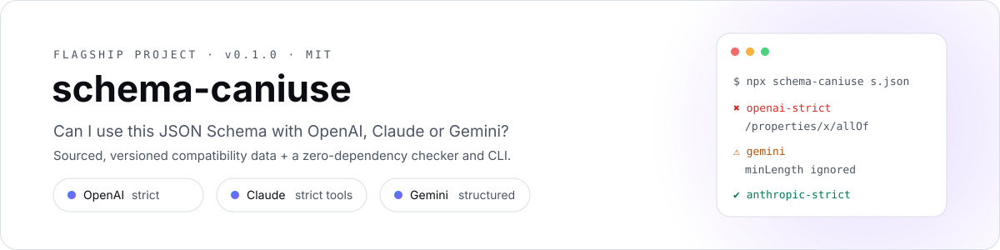
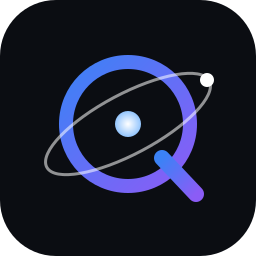

<a href="https://ovaldino05.github.io/QuantumImpactTech/?lang=es">
  <picture>
    <source media="(prefers-color-scheme: dark)" srcset="assets/banner-dark.svg">
    
  </picture>
</a>

<p align="center"><a href="README.md">English</a> · <b>Español</b></p>

### Hola, soy Ovaldino.

Estudio el primer año de **Desarrollo de Aplicaciones Tecnológicas** en la **Universidad de Panamá**, con formación académica previa en **administración financiera**. Construyo infraestructura de código abierto para desarrolladores que trabajan con IA: herramientas pequeñas, con fuentes, probadas y fáciles de verificar.

- **Construyendo:** [schema-caniuse](https://github.com/Ovaldino05/QuantumImpactTech/tree/main/packages/schema-caniuse), una base de datos de compatibilidad de JSON Schema para LLMs.
- **Investigando:** un SDK abierto para la Factura Electrónica de Panamá (`sfep-pa`).
- **Me interesan:** herramientas de IA para desarrolladores, fintech, análisis de riesgo y seguridad de software.
- **Principio:** cada afirmación de mis proyectos enlaza a una fuente; cada métrica de esta página es real.

## Proyecto insignia · schema-caniuse

<a href="https://github.com/Ovaldino05/QuantumImpactTech/tree/main/packages/schema-caniuse">
  <picture>
    <source media="(prefers-color-scheme: dark)" srcset="assets/schema-caniuse-dark.svg">
    
  </picture>
</a>

OpenAI, Claude y Gemini aceptan subconjuntos *distintos* de JSON Schema. `schema-caniuse` reúne esas reglas en un solo conjunto de datos versionado, donde cada dato cita la documentación oficial, y ofrece un verificador sin dependencias que señala la ubicación exacta de cada problema.

```sh
npx schema-caniuse herramientas.json --target openai-strict,gemini
```

[Probar en el navegador](https://ovaldino05.github.io/QuantumImpactTech/?lang=es#playground) · [Issues para empezar](https://github.com/Ovaldino05/QuantumImpactTech/issues?q=is%3Aopen+label%3A%22good+first+issue%22) · [Hoja de ruta](https://github.com/Ovaldino05/QuantumImpactTech/blob/main/ROADMAP.md)

## Impacto en vivo

<picture>
  <source media="(prefers-color-scheme: dark)" srcset="https://raw.githubusercontent.com/Ovaldino05/Ovaldino05/output/stats-dark.svg">
  
</picture>

Metas a 12 meses (objetivos, no resultados): 200.000 descargas mensuales, 500 repositorios dependientes, 100 PRs fusionados en otros proyectos, 20 colaboradores externos y Criticality Score ≥ 0,4. Seguimiento público en la [matriz de cumplimiento](https://github.com/Ovaldino05/QuantumImpactTech/blob/main/docs/MATRIZ.md).

## QuantumImpactTech



**QuantumImpactTech** es mi iniciativa de código abierto (no es una empresa), donde cada proyecto vive con su hoja de ruta, su política de seguridad y sus métricas públicas.
[Proyectos](https://github.com/Ovaldino05/QuantumImpactTech) · [Sitio web](https://ovaldino05.github.io/QuantumImpactTech/?lang=es)

<br clear="left">

<sub>Las imágenes de esta página se generan en este repositorio con GitHub Actions a partir de datos públicos de GitHub y npm. Parte de mis proyectos se escribe con asistencia de IA; reviso y entiendo cada cambio antes de publicarlo.</sub>
