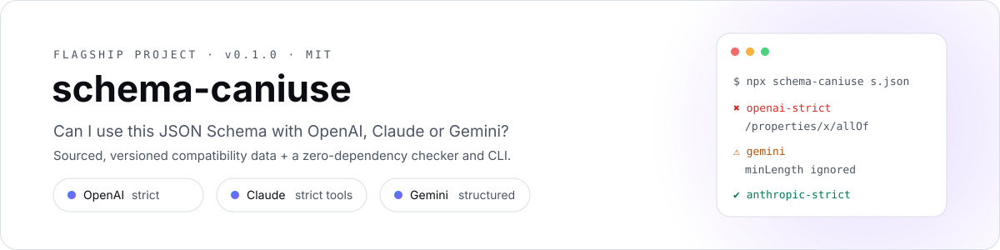
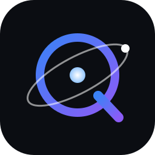

<!-- Profile README for github.com/Ovaldino05 — copy the contents of this folder to the root of the Ovaldino05/Ovaldino05 repository. -->
<a href="https://ovaldino05.github.io/QuantumImpactTech/">
  <picture>
    <source media="(prefers-color-scheme: dark)" srcset="assets/banner-dark.svg">
    
  </picture>
</a>

<p align="center">
  <a href="https://ovaldino05.github.io/QuantumImpactTech/"></a>
  <a href="https://github.com/Ovaldino05/QuantumImpactTech/tree/main/packages/schema-caniuse"></a>
  <a href="https://github.com/Ovaldino05/QuantumImpactTech/blob/main/ROADMAP.md"></a>
  <a href="README.es.md"></a>
</p>

### Hi, I'm Ovaldino.

I'm a first-year **Technology Application Development** student at **Universidad de Panamá**, with a prior academic background in **financial administration**. I build open-source infrastructure for developers working with AI — tools that are small, sourced, tested and easy to trust.

- **Building:** [schema-caniuse](https://github.com/Ovaldino05/QuantumImpactTech/tree/main/packages/schema-caniuse), a compatibility database for LLM JSON Schemas.
- **Researching:** an open SDK for Panama's e-invoicing system (`sfep-pa`).
- **Interested in:** AI developer tooling, fintech, risk analysis and software security.
- **Principle:** every claim in my projects links to a source; every metric on this page is real.

<br>

## Flagship · schema-caniuse

<a href="https://github.com/Ovaldino05/QuantumImpactTech/tree/main/packages/schema-caniuse">
  <picture>
    <source media="(prefers-color-scheme: dark)" srcset="assets/schema-caniuse-dark.svg">
    
  </picture>
</a>

**The problem.** OpenAI, Claude and Gemini each accept a *different* subset of JSON Schema for structured outputs and tool calling. OpenAI strict mode rejects `allOf`; Gemini silently ignores `minLength`; Claude's SDK strips `maximum` before sending. Every agent framework maintains its own hand-written list of these rules — and the lists drift.

**The approach.** One shared, versioned dataset where every fact cites the provider's official docs and a verification date, plus a zero-dependency checker that points to the exact JSON Pointer of each problem. Undocumented behavior is reported as `unknown`, never guessed.

```sh
npx schema-caniuse tools.json --target openai-strict,anthropic-strict,gemini
```

```js
import { check } from 'schema-caniuse';
check(schema, 'openai-strict').issues;
// [{ severity: 'error', path: '/properties/x/allOf', message: '"allOf" is not supported…' }]
```

<p>
  <a href="https://github.com/Ovaldino05/QuantumImpactTech/actions/workflows/ci.yml"></a>
  <a href="https://scorecard.dev/viewer/?uri=github.com/Ovaldino05/QuantumImpactTech"></a>
  
  
  
</p>

| | |
|---|---|
| **Status** | `v0.1.0` — 17 tests, CI on Node 18 / 20 / 22 |
| **Targets** | `openai-strict` · `anthropic-strict` · `gemini` |
| **Next** | Mistral & AWS Bedrock targets · Python package · live API verification |
| **Try it** | [Interactive playground](https://ovaldino05.github.io/QuantumImpactTech/#playground) · [Docs](https://github.com/Ovaldino05/QuantumImpactTech/tree/main/packages/schema-caniuse#readme) |
| **Contribute** | [Good first issues](https://github.com/Ovaldino05/QuantumImpactTech/issues?q=is%3Aopen+label%3A%22good+first+issue%22) · [Help wanted](https://github.com/Ovaldino05/QuantumImpactTech/issues?q=is%3Aopen+label%3A%22help+wanted%22) |

<br>

## Live impact

<picture>
  <source media="(prefers-color-scheme: dark)" srcset="https://raw.githubusercontent.com/Ovaldino05/Ovaldino05/output/stats-dark.svg">
  
</picture>

<details>
<summary><b>12-month goals</b> (targets, not results)</summary>

<br>

| Goal | Target | Verify |
|---|---|---|
| Monthly npm downloads | 200,000 | [npm](https://www.npmjs.com/package/schema-caniuse) |
| Dependent repositories / packages | 500 / 100 | [deps.dev](https://deps.dev/npm/schema-caniuse) |
| Merged PRs to other projects | 100 | [search](https://github.com/search?q=is%3Apr+is%3Amerged+author%3AOvaldino05+-user%3AOvaldino05&type=pullrequests) |
| External contributors on one repo | 20 | [contributors](https://github.com/Ovaldino05/QuantumImpactTech/graphs/contributors) |
| OpenSSF Criticality Score | ≥ 0.4 | [criticality_score](https://github.com/ossf/criticality_score) |

Progress is tracked publicly in the [compliance matrix](https://github.com/Ovaldino05/QuantumImpactTech/blob/main/docs/MATRIZ.md). Nothing is marked done without public evidence.
</details>

<br>

## Activity

<picture>
  <source media="(prefers-color-scheme: dark)" srcset="https://raw.githubusercontent.com/Ovaldino05/Ovaldino05/output/3d-dark.svg">
  
</picture>

<picture>
  <source media="(prefers-color-scheme: dark)" srcset="https://raw.githubusercontent.com/Ovaldino05/Ovaldino05/output/snake-dark.svg">
  
</picture>

<br>

## Toolbox

<picture>
  <source media="(prefers-color-scheme: dark)" srcset="assets/stack-dark.svg">
  
</picture>

<br>

## QuantumImpactTech



**QuantumImpactTech** is my open-source initiative — not a company — where every project lives with its roadmap, security policy and public metrics.
[Projects](https://github.com/Ovaldino05/QuantumImpactTech) · [Website](https://ovaldino05.github.io/QuantumImpactTech/) · [Roadmap](https://github.com/Ovaldino05/QuantumImpactTech/blob/main/ROADMAP.md) · [Security](https://github.com/Ovaldino05/QuantumImpactTech/blob/main/SECURITY.md)

<br clear="left">

## Let's build together

Found a provider behavior that `schema-caniuse` gets wrong? That's the most valuable contribution there is.

<a href="https://github.com/Ovaldino05"></a>
<a href="https://github.com/Ovaldino05/QuantumImpactTech/issues/new/choose"></a>

<sub>Images on this page are generated in this repository by GitHub Actions from public GitHub and npm data. Parts of my projects are written with AI assistance; I review and understand every change before it ships.</sub>
